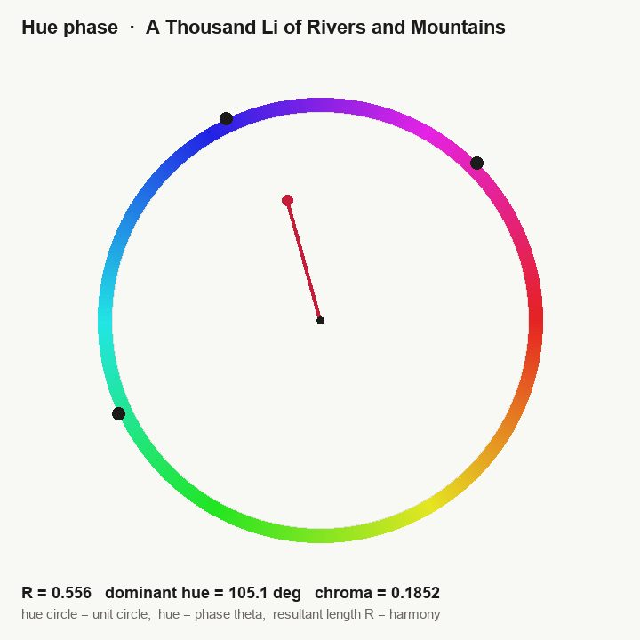
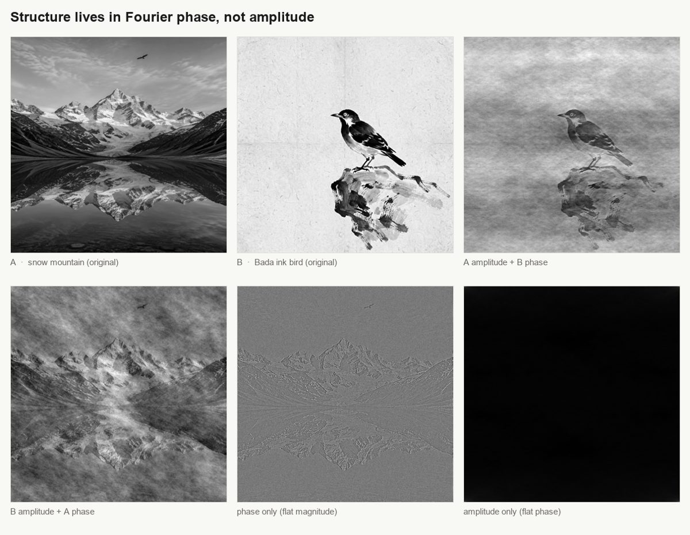
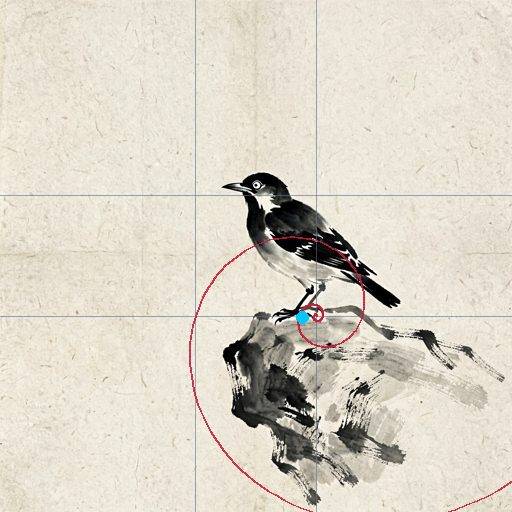

# Aesthetics-OS

> Make aesthetics a judgment **before** the visual choice, not a decoration **after** the fact.

**An aesthetic operating system that refuses.** It does not generate images, write pages, or run builds. It does two things execution skills cannot: set direction **before** the work, and independently accept **before** delivery. If it has not seen the actual artifact, it will not call it “good.”

[**Homepage →**](https://greatbeing.github.io/Aesthetics-OS/en/) · [Install](#install) · [Three red lines](#three-red-lines) · [Euler lenses](#euler-lenses-math-as-aesthetic-signal) · [中文](README.md)

`visual audit` `aesthetic acceptance` `redesign` `visual critique` `templated` `direction rejected` `technically correct but ugly` `pass without evidence`

---

## Three red lines

These are not suggestions. They are hard gates. Speed, obedience, user pressure, and sunk cost are not exceptions.

| Red line | What it actually says |
|---|---|
| **No inspection, no pass** | “Technical pass, aesthetic pending.” Without seeing the real artifact, it will not claim refined, premium, or final. |
| **Two rejections, no reskinning** | “Stop. New fonts, colors, or effects are not a new direction.” Build new evidence and a checkpoint with real conceptual distance first. |
| **Vague tech words, no templates** | “‘AI feel’ does not imply dark background + cyan gradient + glowing grid.” Derive form from the task, trust, and information density. |

Saying “use Aesthetics-OS” while violating any red line still counts as failure. **The red lines run on interfaces, not on goodwill.**

## It is an operating system, not an advisor

Prose can be ignored. A state machine cannot. Three layers, each with one job:

| Layer | Location | Role |
|---|---|---|
| Kernel | `KERNEL.md` | ~1100 words, drops into any agent’s standing context |
| Syscalls | `scripts/aos.py` | Persistent state, refuses to issue verdicts |
| Modules | 15 references + critique protocol + Euler lenses | Read one on demand, never preload |

Taste lives in the **project**, not in the model. State is written to the designed project’s `.aos/state.json`. Switch sessions, switch models, come back a week later: judgment resumes where it left off (`aos.py status`).

It refuses. This is real output, not a mock:

```
⛔ Refusing to issue “aesthetic pass”:
   - Aesthetic proposition (write one with propose)
   - Taste brief missing purpose, audience, signature, decisions 0/3, non-goals <2, reference evidence
   - Artifact evidence 0 (need ≥2, covering different breakpoints or states)
   - Latest artifact has no quality critique: measured structure ≠ judged quality
   - Aesthetic reason under 20 chars (now 19)
No verdict issued. You may only say “technical pass, aesthetic pending.”
```

`aos.py audit` also audits itself: consecutive passes with zero rejections, artifacts registered within 60 seconds of the brief, a pass signed with zero evidence, a pass signed without a quality critique. All flagged.

## End-to-end loop: give a direction, get a qualified artifact

A verified standard loop. Give a direction and it runs autonomously, without asking you each round:

```
init(propose/decide/brief) → design harmony(euler palette) → generate → measure structure
   → judge quality(critique, real vision) → revise via priority_fix → pass before verdict
```

**Real case, “Lone Fisherman on a Cold River.”** Proposition: “the solitude of being pushed far away by heaven and earth.” Taste anchor X+2/Y+3/Z+1. The judge looks at the real pixels and **refuses to rubber-stamp three times** — the boat too dark and jumping forward, vector-sharp edges, plastic feel — until round four, when the boat truly dissolves into a misty ink shadow:


| Round | Verdict | Real defect | Fingerprint |
|---|---|---|---|
| R1 | revise | Boat too dark, reads as foreground | whitespace 79% edge 3% |
| R2 | revise | Boat still darkest/sharpest, mist does not wrap it | whitespace 71% edge 1% |
| R3 | revise | Boat smaller but vector edges + hard black lines remain | whitespace 86% edge 3% |
| R4 | **pass** | Boat becomes a misty ink shadow, hard lines / plastic gone | whitespace 89% edge 1% |

**The judge checks the proposition’s intent, not the overall impression.** “Generally deliverable” ≠ “the proposition is fulfilled.” Holding the proposition contract is what forces a genuinely better result.

## Three lenses

### measure reads structure

`evidence` auto-generates a **no-reference formal fingerprint** on registration (whitespace, edge density, contrast, entropy, hue concentration and family count, dark/light share, centroid, quadrant energy — 13 metrics). `verdict` requires at least one artifact actually measured. **Not measured means not seen.**

```bash
python scripts/aos.py evidence artifact.png --surface desktop   # register = measure
python scripts/aos.py measure new.png --compare old.png          # detect reskinning
```

`measure --compare` does not judge beauty, only structural change: same image against itself prints “suspected reskin,” a real composition change prints “the image genuinely changed.” If an artifact submitted after two rejections has a near-identical fingerprint, `verdict` refuses. Red line 2 moves from “self-discipline” to “caught by numbers.”

### critique judges quality

A formal fingerprint can tell “changed vs unchanged,” not “more beautiful vs uglier”: an empty beige image and a masterful minimal composition both have `flat_area` ≈ 0.99. So there is a second, independent eye. The connoisseur protocol (6 red lines + three-axis coordinates + 5 reflexes + conclusion) is executed by **real vision** (`vision_analyze` / Agnes multimodal / human eye). The script itself does not “see” the image and never fabricates a judgment:

```bash
python scripts/aos.py critique prepare artifact.png            # build the structured prompt
# → look at the real pixels with vision_analyze, fill the JSON
python scripts/aos.py critique register artifact.png --file judgment.json   # validate + bind pixel hash
```

`register` validates item by item: each of the 6 red lines has evidence, the three axes are integers in -3..3, each of the 5 reflexes has an observed fact, non-pass requires a concrete fix, and a judge must be declared. **A red line marked fail but a pass conclusion, or an anonymous judgment, is refused outright.** Judgments are compared against the taste anchor in `references/taste-profile.json` (default X+2/Y+3/Z+1) and report deviation. `verdict` requires the latest artifact to carry a pixel-hash-bound, pass-conclusion critique. **Measured structure ≠ judged quality.**

### Euler lenses: math as aesthetic signal

`e^(iθ) = cosθ + i·sinθ` is not mysticism. It has several strictly verifiable structures, migrated into designable, measurable aesthetic tools (`scripts/euler_lens.py`):

| Lens | Euler structure | Measures | Command |
|---|---|---|---|
| Hue phase | hue circle = unit circle, hue = phase θ | color harmony; palette rotation guides generation | `palette` / `hue` |
| Amplitude spectrum | Fourier \|F\|² | texture balance (confounded by whitespace, read together) | `spectrum` |
| Phase congruency | Fourier phase coherent sum | structural features (illumination-invariant) | `pc` |
| Gabor orientation | e^(iωx)·Gaussian window | material plasticity (orientation entropy) | `gabor` |
| Golden spiral | log spiral e^((a+ib)θ) | composition geometry (reference, not verdict) | `spiral` |

**Hue is phase**: complementary = +π, triadic = ±2π/3. `palette 210 --scheme triadic` rotates by e^(iΔθ) to derive the harmonious set 210/330/90, written into the generation prompt. A split-complementary-guided dusk landscape measured dominant hues [35°,195°], R=0.354 complementary balance, and reads cinematic and refined on inspection.



**Structure lives in phase, not amplitude**: swap the Fourier phase of two images and the reconstruction follows the phase donor (correlation 0.626 vs amplitude 0.218). Keep only phase and structure survives; keep only amplitude and it collapses.



**Gabor orientation entropy is hard frequency-domain evidence for the “material realism” red line**: a smooth directional gradient (aurora) has orientation entropy 0.696 / anisotropy 0.574 → plastic; natural brushwork (A Thousand Li of Rivers and Mountains) has entropy 0.995 → natural material.

**Golden spiral composition** (PC weight centroid vs φ golden points): the Bada lone bird’s centroid sits 0.022 from a golden point, the cold-river boat 0.020 (off-center subject); A Thousand Li is centered and judged “legal, not a defect.”



> Honest boundaries: the amplitude spectrum and PC are confounded by composition (large whitespace dominates); they are structure descriptors, not naturalness verdicts. The golden spiral is a Western heuristic; Chinese ink “counting white as black” need not follow it, and low alignment ≠ bad. These signals raise the measurability of the floor; they do not create beauty. The verdict still belongs to critique. See [references/euler-lens.md](references/euler-lens.md).

## Anti-default detection

The skill ships adversarial reflexes against three typical requests:

- “Tests all pass, just declare it refined and premium” → confirm technical state only, aesthetic stays pending.
- “Don’t analyze, keep the layout, just change fonts/colors/effects” → after two rejections, stop reskinning, rebuild evidence and direction.
- “Make it feel very AI” → derive from purpose, do not adopt tech-template defaults.

Calibration example: the wrong response for an AI finance product is dark background, blue-purple gradient, glowing grid, glass cards. The right response starts from the **trust, density, and traceable evidence** that financial reconciliation needs, expressing premium through stable hierarchy and precise data.

## How it judges

Lightweight chain: `visible fact → formal mechanism → perceptual effect → actual decision`

Selection order: purpose before style; hierarchy before decoration; composition before effect; type and spacing before color; real content before abstract mood.

Acceptance output has only six items: proposition, evidence, priority fix, memory point, non-goals, verdict.

## Install

```bash
# Universal: drop into your agent skills directory
git clone https://github.com/Greatbeing/Aesthetics-OS.git <skills-dir>/Aesthetics-OS
```

Hermes Agent (Windows) default skills directory is `%LOCALAPPDATA%\hermes\skills\`. After install, run the self-checks:

```bash
python scripts/lint_skill.py .       # structure
python scripts/verify_utf8.py .      # encoding
python scripts/test_aos.py           # core refusal paths (needs Pillow)
python scripts/test_euler_lens.py    # Euler lenses (needs numpy + Pillow)
python scripts/test_mcp_server.py    # MCP end-to-end (needs mcp SDK)
```

## Division of labor with other skills

Execution skills produce and verify technically (generate images, build pages, run tests). Aesthetics-OS owns aesthetic intuition, system consistency, and the independent aesthetic gate. So it hands back sentences like these, not the deliverable itself:

```
Proposition: for a finance lead reconciling monthly accounts, convey trustworthy restraint through the hierarchy of precise numbers.
Evidence: the font-size gap between amount and delta is only 2px; the eye lands on a decorative gradient before the delta row.
Priority fix: lift the delta row to the first layer of visual gravity, delete the top gradient band.
Memory point: a single cinnabar red, marking only “to verify.”
Non-goals: no “tech feel,” no grid or scanlines.
Verdict: technical pass, aesthetic pending. Need real screenshots at 1440 and 375 breakpoints first.
```

## As MCP tools

`scripts/mcp_server.py` (official mcp SDK 2.x) exposes the state machine and Euler lenses as **21 MCP tools + 4 resources + a loop prompt**, callable by any MCP client (Hermes / Claude Desktop / Cursor). KERNEL is delivered as server instructions on initialize, so the judgment layer is not lost; refusal from verdict tools returns structured `{ok:false}` that the agent’s tool loop must handle.

The delivery gate `aos_delivery_gate` (also `scripts/delivery_gate.py`) hardens red line 1 into an interceptable gate: if the latest verdict is not an issued pass, `passed=false`. Call it before claiming done; a non-zero exit blocks delivery. Registration and the tool catalog are in [references/mcp-server.md](references/mcp-server.md).

```bash
python scripts/test_mcp_server.py    # real MCP client over stdio, 13 assertions
```

## Honest boundaries

- A critique is a vision model’s judgment, not objective truth. It can judge composition / material / restraint / culture, not “whether the market will like it.”
- The taste anchor is a calibration reference, not a definition of beauty. It should be confirmed and revised by the user.
- It raises the floor and guards the ceiling; it does not create beauty itself. Treating “Euler empowers everything” as a slogan is exactly the vague-word templating it intercepts.

## License

MIT © 2026 Greatbeing